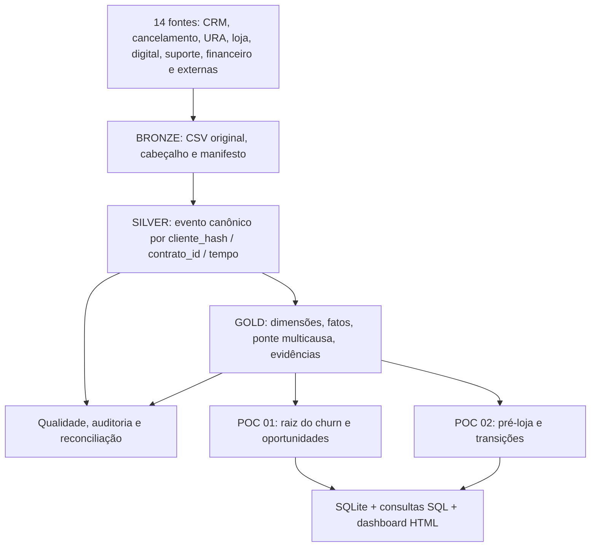

<div align="center">

# 📡 CLARO | Customer Journey & Churn Intelligence

### Engenharia de dados aplicada à investigação da jornada e às causas de cancelamento

**Estudo técnico / POC v0.1 — Outubro de 2026**

Plataforma demonstrativa para **reconstruir a jornada de clientes cancelados**, cruzar fontes operacionais de **Móvel e Fixa**, explicar **hipóteses de causa raiz** com evidências rastreáveis e identificar **pontos de atrito entre canais** antes da saída.


**URA • Lojas e PDV • App • Site • Suporte • Visitas Técnicas • Cobrança • Reclamações • Concorrência**

</div>

---

> [!IMPORTANT]
> **Projeto demonstrativo e não oficial.** Todos os clientes, cancelamentos, contatos, transcrições, preços e indicadores deste repositório são **sintéticos**. Não há dados pessoais reais, acesso corporativo à CLARO ou integração ativa com concorrentes, Anatel ou Reclame Aqui. A licença MIT cobre o código desta POC, não direitos sobre marcas de terceiros.

## Sumário

- [Visão geral](#visão-geral)
- [Objetivos e decisões do estudo](#objetivos-e-decisões-do-estudo)
- [Recorte temporal](#recorte-temporal)
- [Arquitetura](#arquitetura)
- [Produtos e fontes](#produtos-e-fontes)
- [Modelo analítico e relacionamentos](#modelo-analítico-e-relacionamentos)
- [POC 01 — Investigação dos cancelamentos](#poc-01--investigação-dos-cancelamentos)
- [POC 02 — Jornada anterior à loja](#poc-02--jornada-anterior-à-loja)
- [Indicadores e hipóteses](#indicadores-e-hipóteses)
- [Resultados sintéticos de demonstração](#resultados-sintéticos-de-demonstração)
- [Estrutura do repositório](#estrutura-do-repositório)
- [Pré-requisitos e configuração](#pré-requisitos-e-configuração)
- [Execução dos pipelines](#execução-dos-pipelines)
- [SQL, dashboard e análise](#sql-dashboard-e-análise)
- [Qualidade e rastreabilidade](#qualidade-e-rastreabilidade)
- [Governança e LGPD](#governança-e-lgpd)
- [Integração de cabeçalhos reais](#integração-de-cabeçalhos-reais)
- [Status e roadmap](#status-e-roadmap)
- [Publicação no GitHub](#publicação-no-github)
- [Contribuição e licença](#contribuição-e-licença)

---

## Visão geral

**Pergunta principal:** *Qual é o motivo real do cancelamento, considerando todo o histórico de contatos e problemas observáveis do cliente, e não apenas o motivo digitado no encerramento?*

A POC reconstrói a jornada por **cliente pseudonimizado** e **contrato**, sincroniza a linha do tempo entre sistemas, separa problemas técnicos, financeiros, de atendimento, preço/oferta, comercial e concorrência e registra a origem de cada evidência. É possível inspecionar a diferença entre o **motivo declarado** e a **causa principal inferida**, sabendo que inferência baseada em regras ainda precisa de validação operacional.

O projeto começa com **14 fontes fictícias**, pipeline reproduzível, tabelas Gold, warehouse SQLite, consultas SQL, um dashboard HTML e testes automáticos. Ao receber o dicionário real de cada fonte, o mapeamento será substituído gradualmente sem destruir o modelo analítico.

### Princípios

| Princípio | Aplicação |
|---|---|
| Rastreabilidade | Toda evidência preserva `fonte`, `id_origem`, `cliente_hash`, `contrato_id` e data |
| Rigor temporal | Só contam eventos anteriores ao cancelamento na análise de 180 dias |
| Não confundir associação e causa | Múltiplos sinais podem existir; resultado é hipótese investigativa |
| Uma causa principal, múltiplos fatores | Fato 1:1 por cancelamento + ponte N:N de motivos |
| Sem causa inventada | `indeterminado` quando não há evidência suficiente |
| LGPD by design | Dados 100% fictícios; vínculo por HMAC-SHA256 na demonstração |
| Reprodutibilidade | Mesmo seed e mesmo pipeline = mesmos resultados |
| Independência de canal | Fontes originais preservadas e eventos normalizados |
| Evolução segura | Contratos de tabelas, testes, SQL e documentação versionados |

---

## Objetivos e decisões do estudo

**Objetivo de negócio:** identificar problemas recorrentes e pontos de falha na jornada de clientes que cancelaram em outubro de 2026, separando **Móvel** e **Fixa**.

**Objetivos analíticos:** reconstruir cada interação; classificar todas as ligações disponíveis; calcular reincidência e tempo de resolução; investigar reclamações; mapear fatores financeiros; avaliar pressão competitiva de forma contextual e identificar oportunidades de prevenção do churn.

**Dois produtos entregues no mesmo repositório:**

| Frente | Questão | Artefato principal |
|---|---|---|
| **POC 01 — Churn / Causa** | *Por que o cliente cancelou?* | `fct_cancelamentos_analitica`, `fct_evidencias_motivo`, `bridge_cancelamento_motivo` |
| **POC 02 — Pré-loja** | *Ele acionou URA/app/site/suporte antes de ir à loja?* | `fct_pre_loja_30d`, `fct_transicoes_canais` |

A mesma arquitetura e a mesma chave alimentam as duas POCs, mas cada análise possui indicadores e resultados independentes.

---

## Recorte temporal

```text
                        JORNADA COMPARATIVA
2026   ABRIL    MAIO    JUNHO    JULHO    AGOSTO   SETEMBRO   | OUTUBRO |
       ├────────────────── 183 dias ───────────────────────────┤  coorte
       └──── Histórico mensal fechado para análise de tendência ┘     ↓
                                             Cancelamentos 01/10–31/10

Para cada cliente: [dt_cancelamento - 180 dias, dt_cancelamento)
Para cada visita a loja: [dt_visita - 30 dias, dt_visita)
```

> **Atenção ao calendário:** de 01/04/2026 a 30/09/2026 são **183 dias**, não 180. Para atender aos dois objetivos, mantemos o intervalo fixo de seis meses e, separadamente, os **180 dias exatos anteriores à data/hora de cada cancelamento**. Assim, um contato em outubro **antes da saída** pode ser causalmente relevante.

A POC mede **resolução de tickets em até 30 dias** do momento de abertura, limitado à informação disponível até o corte do estudo; não confundir com SLA oficial da CLARO.

---

## Arquitetura



O desenho medallion evita um erro clássico de relacionar todas as tabelas brutas por cliente: a multiplicação de linhas e a inflação de chamadas, faturas e visitas. **As tabelas Gold respeitam a granularidade** de cada fato e preservam IDs de origem.

- Diagrama completo e ERD: [docs/arquitetura.md](docs/arquitetura.md)
- Fluxogramas das duas POCs: [docs/fluxogramas.md](docs/fluxogramas.md)

---

## Produtos e fontes

### Segmentação de produtos

| Produto | Descrição do cenário | Particularidade |
|---|---|---|
| `MOVEL` | Serviço de telefonia/chip/plano mensal | Não há visita técnica residencial na POC; atendimento técnico pode ocorrer em loja |
| `FIXA` | Internet residencial/aparelho/equipamento | Possui ticket e visita técnica residencial |

### 14 fontes fictícias separadas

| Fonte CSV | Assunto | Informação chave |
|---|---|---|
| `clientes` | Dimensão de clientes | Cliente pseudonimizado, região, ativação |
| `contratos` | Serviços e planos | Contrato, produto, mensalidade, status |
| `cancelamentos` | Coorte alvo | Data/hora e motivo declarado |
| `ura_ligacoes` | Voz inbound/outbound | Ligação, tema, protocolo, transferências, transcrição fictícia |
| `loja_atendimentos` | Loja própria e ponto de venda | Visita, motivo e resolutividade |
| `digital_interacoes` | Site e aplicativo | Ação, tema, resultado |
| `suporte_tickets` | Tickets de suporte | Abertura, encerramento, status |
| `visitas_tecnicas` | Técnico residencial Fixa | Ordem de serviço, diagnóstico, resolução |
| `faturas` | Cobrança | Vencimento, pagamento, atraso, status |
| `acordos_financeiros` | Negociação | Acordo, parcelas, status |
| `reclamacoes` | Ouvidoria e Reclame Aqui **simulados** | Tema, origem, resposta, status |
| `portabilidades` | Evento de destino **simulado/autorizado** | Destino e evidência de verificação |
| `pesquisas_saida` | Pesquisa após saída | Motivo declarado em pesquisa, concorrente informado |
| `ofertas_mercado` | Preços **fictícios** de concorrentes | Prestadora, região, produto, mês, preço |

> Todas as fontes de natureza individual possuem `cliente_hash`, exceto `ofertas_mercado`: ofertas são informações **agregadas de mercado**, sem cliente. Forçar `cliente_hash` em dados de mercado inventaria vínculos inexistentes.

O cabeçalho e a descrição de cada coluna estão em [docs/dicionario_dados.md](docs/dicionario_dados.md).

---

## Modelo analítico e relacionamentos

A **chave de estudo** `cliente_hash` é criada por **HMAC-SHA256** sobre um identificador artificial. Ela é estável em cada fonte individual e relacionada à chave adicional `contrato_id`.

```text
DIM_CLIENTE (cliente_hash)
  └── DIM_CONTRATO (contrato_id, cliente_hash)
        ├── FCT_JORNADA_EVENTOS (evento_id, dt_evento, canal, fonte, id_origem)
        ├── FCT_CANCELAMENTOS_ANALITICA (cancelamento_id, causa_principal)
        │     ├── BRIDGE_CANCELAMENTO_MOTIVO (motivo, papel, escore)
        │     └── FCT_EVIDENCIAS_MOTIVO (fonte, id_origem, pontuacao)
        ├── FCT_RESOLUCAO_30D (ticket_id)
        └── FCT_PRE_LOJA_30D (atendimento_loja_id)

DIM_CANAL / DIM_MOTIVO / DIM_TEMPO  -> dimensões analíticas
FCT_OFERTAS_MERCADO               -> somente mes_ref + regiao + produto
```

**Regra de integridade:** `cliente_hash` não significa criptografia reversível, tampouco anonimização garantida. Em ambientes reais, o segredo deve vir de cofre corporativo; a tabela de correspondência deve ficar segregada e o tratamento exige base legal e restrição de acesso.

---

## POC 01 — Investigação dos cancelamentos

**Etapas:** identificar a coorte de outubro → filtrar 180 dias anteriores → unir eventos ordenados → classificar ligações → pontuar evidências → confrontar motivo declarado → registrar causa principal/causas contribuintes/confiança → calcular oportunidades.

### Famílias de problemas

| Grupo | Exemplos de observação |
|---|---|
| `tecnico` | Sem sinal, instabilidade, visitas repetidas, ticket aberto |
| `financeiro` | Fatura em atraso, acordo quebrado, inadimplência |
| `atendimento` | Falhas de resolução, repetições, transferências |
| `preco_oferta` | Queixa de preço, desconto, adequação de plano |
| `concorrencia` | Portabilidade **autorizada** ou concorrente **autodeclarado** |
| `comercial` | Plano divergente, venda/contratação incorreta |
| `indeterminado` | Fontes insuficientes para inferir causa |

**Todas as ligações fictícias são classificadas**, inclusive inbound e outbound, em `fct_ligacoes_classificadas.csv` (1.008 ligações). A análise principal de churn filtra adicionalmente **somente as 621 ligações de contratos cancelados na janela individual de 180 dias**, usando `em_janela_180d_pre_cancelamento=1`. O algoritmo atual usa **palavras-chave e tema**, com nível de confiança demonstrativo: não é ASR nem NLP treinado, e as transcrições são artificiais.

**Causa principal** é exclusiva por cancelamento; **motivos contribuintes** podem coexistir. Nenhuma promoção externa isolada é motivo suficiente para dizer que o cliente mudou para VIVO, TIM, ALGAR ou qualquer outra empresa.

**Artefatos:** `reports/poc01_motivos_por_produto.csv`, `poc01_declarado_vs_inferido.csv`, `poc01_ligacoes_por_tema.csv` (somente coorte), `poc01_ligacoes_todas_por_tema.csv` (todos), `poc01_oportunidades.csv`, `poc01_kpis.json`.

---

## POC 02 — Jornada anterior à loja

Cada visita à loja gera uma linha em `fct_pre_loja_30d` com os **30 dias anteriores**. São calculados:

- Chamadas URA inbound/outbound, interações APP e SITE, tickets e visita técnica residencial (apenas Fixa);
- Se houve contato anterior à loja; se usou 2+ canais; primeiro e último canal na janela;
- Tempo em horas desde a última interação e sequência ordenada, exemplo: `APP > URA_INBOUND > LOJA`;
- Transições adjacentes entre canais durante a jornada de 180 dias.

A análise tem **dois denominadores distintos**: visitas à loja (evento) e clientes/contratos únicos com loja (última visita na janela). O relatório de proporções pré-loja usa o segundo, evitando dupla contagem de clientes reincidentes.

**Artefatos:** `reports/poc02_clientes_pre_loja.csv`, `poc02_kpis.json`, `data/gold/fct_pre_loja_30d.csv`, `data/gold/fct_transicoes_canais.csv`.

---

## Indicadores e hipóteses

| Indicador | Definição resumida |
|---|---|
| % causa principal por produto | Cancelados com causa X ÷ total cancelados daquele produto |
| Fatores contribuintes | Cancelados com evidência por categoria; podem se sobrepor |
| Chamadas por problema | Ligações classificadas X ÷ total de ligações |
| Reincidência de atendimento | Quantidade de contatos não resolvidos na janela |
| Tempo de resolução | Tempo entre abertura e fechamento do ticket, até o corte |
| % pré-loja com URA | Clientes com URA em 30 dias antes da última visita ÷ clientes com loja |
| % pré-loja multicanal | Clientes com dois canais anteriores ÷ clientes com loja |
| Pressão de preço | Diferença contextual entre mensalidade e oferta regional de mercado |
| Incerteza / lacuna | Percentual de cancelamentos sem evidência individual suficiente |

Plano de hipóteses H01–H12, métricas, vieses, limiares, regras e metodologia: [docs/hipoteses_e_metricas.md](docs/hipoteses_e_metricas.md).

---

## Resultados sintéticos de demonstração

A execução determinística de v0.1 (seed `202610`) entrega:

| Indicador | Resultado da simulação |
|---|---:|
| Clientes fictícios | **600** |
| Cancelamentos fictícios em outubro | **240** |
| Móvel cancelado | **144** |
| Fixa cancelada | **96** |
| Eventos canônicos de jornada | **6.905** |
| Ligações classificadas (todos os clientes) | **1.008** |
| Ligações na coorte cancelada / janela 180 dias | **621** |
| Atendimentos de loja | **228** |
| Clientes distintos com loja | **206** |
| Clientes com URA em 30 dias antes da última loja | **138 (66,99%)** |
| Clientes multicanal em 30 dias antes da última loja | **136 (66,02%)** |
| Cancelados sem causa suficiente | **17 (7,08%)** |
| Validações de dados | **67 PASS** |

> [!CAUTION]
> **Estes números foram programaticamente gerados e não são descobertas sobre a operação da CLARO.** O valor da POC é provar arquitetura, chaves, granularidade, rastreabilidade e cálculo antes da ingestão de fontes reais.

---

## Estrutura do repositório

```text
CLARO_CUSTOMER_JOURNEY_CHURN_POC/
├── README.md
├── LICENSE
├── CONTRIBUTING.md
├── pyproject.toml
├── .env.example
├── .gitignore
├── Makefile
├── config/
│   └── taxonomia.json
├── data/
│   ├── raw/synthetic/          # 14 fontes CSV + manifest.json
│   ├── bronze/                 # cópia fiel de cada fonte
│   ├── silver/                 # eventos_canonicos.csv + lineage.json
│   ├── gold/                   # dimensões, fatos, ponte, ofertas
│   ├── warehouse/              # claro_poc.sqlite
│   └── quality/                # quality_report.json
├── src/
│   ├── main.py                 # orquestrador oficial
│   ├── config.py
│   ├── utils.py
│   ├── generate_synthetic.py   # fabrica dados fictícios reproduzíveis
│   ├── transform.py            # Bronze -> Silver -> Gold
│   ├── quality.py              # contratos, 67 verificações
│   ├── poc01_cancelamento.py
│   ├── poc02_pre_loja.py
│   └── report.py               # dashboard HTML local
├── sql/
│   ├── 01_modelo_gold.sql
│   ├── 02_poc01_cancelamentos.sql
│   └── 03_poc02_pre_loja.sql
├── reports/
│   ├── dashboard.html
│   ├── poc01_*.csv / poc01_kpis.json
│   └── poc02_*.csv / poc02_kpis.json
├── docs/
│   ├── arquitetura.md
│   ├── fluxogramas.md
│   ├── dicionario_dados.md
│   ├── hipoteses_e_metricas.md
│   ├── mapeamento_fontes_reais.md
│   ├── governanca_lgpd.md
│   └── roadmap.md
├── scripts/
│   ├── run_all.ps1
│   └── run_all.sh
├── tests/
│   ├── test_end_to_end.py
│   └── test_rules.py
└── .github/workflows/tests.yml
```

---

## Pré-requisitos e configuração

- Python **3.11+** (usamos **somente bibliotecas padrão**, sem download obrigatório de pacotes);
- Windows PowerShell, Linux ou macOS;
- Git para versionamento; SQLite opcional para inspecionar o arquivo `.sqlite` (o Python já cria a base).

### Windows PowerShell

```powershell
# Extrair o ZIP e entrar no diretório
Set-Location "CLARO_CUSTOMER_JOURNEY_CHURN_POC"

# Recomendado: criar virtual environment
python -m venv .venv
.\.venv\Scripts\Activate.ps1

# Opcional — exemplo de variáveis de ambiente, não usar segredo real
Copy-Item .env.example .env

# Pipeline completo
python -m src.main --all

# Testes
python -m unittest discover -s tests -v
```

### Linux / macOS

```bash
cd CLARO_CUSTOMER_JOURNEY_CHURN_POC
python3 -m venv .venv
source .venv/bin/activate
python -m src.main --all
python -m unittest discover -s tests -v
```

O `.env` **não é lido automaticamente pelo Python** nesta versão sem dependências. Para definir uma chave de demonstração no terminal: ` $env:CLARO_HMAC_KEY = "SOMENTE_TESTE" ` (PowerShell) ou `export CLARO_HMAC_KEY=SOMENTE_TESTE` (bash). **Não alterar a chave entre a geração de fontes e as demais etapas**, ou as chaves sintéticas deixarão de corresponder às novas execuções.

---

## Execução dos pipelines

| Comando | Resultado |
|---|---|
| `python -m src.main --all` | Recria fontes sintéticas, camadas, POC 01, POC 02 e dashboard |
| `python -m src.main --generate` | Regenera apenas as 14 fontes CSV |
| `python -m src.main --build` | Reprocessa camadas a partir das fontes existentes, ambas POCs |
| `python -m src.main --poc01` | Reprocessa fontes/camadas e somente POC 01 |
| `python -m src.main --poc02` | Reprocessa fontes/camadas e somente POC 02 |
| `python -m src.main --clean-generated` | Remove derivados; preserva fontes sintéticas |
| `python -m unittest discover -s tests -v` | Testes de regras, saída analítica e relações |
| `python -m src.inspect --sample` | Exibe a timeline e as evidências de um cancelamento fictício |

A execução `--all` é reprodutível pela seed definida em `src/config.py`. Para exploração manual, é possível começar pelos arquivos Gold já entregues no ZIP sem instalar Python.

---

## SQL, dashboard e análise

### Dashboard local

Abra `reports/dashboard.html` no navegador (offline). Ele mostra KPIs da amostra, distribuição de causas por produto e transições mais frequentes entre canais. Todos os valores são artificiais.

### Inspecionar uma jornada completa (exemplo real da simulação, não cliente real)

```powershell
# Exemplo de cliente Fixa com causa técnica inferida
python -m src.inspect --sample --produto FIXA --causa tecnico

# Exemplo de cliente que declarou/registrou mudança de concorrente
python -m src.inspect --sample --causa concorrencia

# Exemplo de caso sem evidência
python -m src.inspect --sample --causa indeterminado
```

A inspeção imprime evento por evento nos 180 dias anteriores, identificando fonte, canal, status, motivo declarado, causa principal e pontos das evidências.

### Consultar o banco com Python

```powershell
@'
import sqlite3
con = sqlite3.connect("data/warehouse/claro_poc.sqlite")
for registro in con.execute("""
    SELECT produto, causa_principal, COUNT(*) AS n
    FROM fct_cancelamentos_analitica
    GROUP BY produto, causa_principal
    ORDER BY produto, n DESC
"""):
    print(registro)
con.close()
'@ | python -
```

Consultas preparadas:

- `sql/01_modelo_gold.sql`: modelo lógico e rastreamento evidência → fonte.
- `sql/02_poc01_cancelamentos.sql`: causas, contribuidores, declarado vs inferido, todas as ligações, resolução 30d e ofertas externas contextuais.
- `sql/03_poc02_pre_loja.sql`: métricas pré-loja por clientes únicos, cancelados vs ativos, transições e trilhas individuais.

Para Power BI futuro: carregar CSVs de `data/gold/` ou conector SQLite apropriado; **não** foi criado um PBIP/TMDL nesta versão.

---

## Qualidade e rastreabilidade

`data/quality/quality_report.json` reúne **67 checagens** de cabeçalho, unicidade, HMAC, existência de contratos/clientes, coorte, ausência de visita residencial no produto Móvel, linhagem de eventos, cobertura de cancelamentos e não atribuição de concorrência sem evidência direta.

Os testes `unittest` (mais 16 verificações) também validam resultado, score de concorrência com evidência, janela fora de 180 dias, integridade do warehouse e métricas pré-loja. O CI em `.github/workflows/tests.yml` executa ambas as camadas automaticamente em push/PR.

**Linhas auditáveis:** `fct_evidencias_motivo` → `fct_jornada_eventos` por `fonte + id_origem + cliente_hash` → `data/bronze/<fonte>.csv`.

---

## Governança e LGPD

- A chave vinculadora **pseudonimiza**, mas **não anonimiza automaticamente** o dado pessoal real; acesso e finalidade continuam regulados.
- Não inserir identificadores reais, gravações ou datasets privados no repositório.
- Apenas dados agregados de ofertas de mercado podem ser ligados por período/região/produto. Não há mecanismo de descoberta de operadora de ex-cliente nesta POC.
- Integração de Reclame Aqui, portabilidade, transcrição e dados de terceiros requer fontes autorizadas, contrato/bases aplicáveis e avaliação de proteção de dados.
- `data/raw/real/`, `data/private/`, `.env` e credenciais permanecem fora do Git.

Detalhes e referências oficiais: [docs/governanca_lgpd.md](docs/governanca_lgpd.md).

---

## Integração de cabeçalhos reais

O próximo ciclo será incremental: você encaminha primeiro o **dicionário das tabelas reais** (URA, loja, app/site, técnico, financeiro etc.) e a equipe define os campos equivalentes, regras e fontes. O pipeline será evoluído sem descartar a estrutura de teste.

1. Validar o grão, chave e carimbo de tempo da fonte.
2. Mapear coluna real → coluna canônica da POC.
3. Reconciliar volumes por mês, produto e canal.
4. Criar testes específicos de nulos, formatos, duplicidades, integridade e hierarquias.
5. Executar a coorte e confrontar classificações com amostra avaliada pelo negócio.
6. Incorporar progressivamente às dimensões e métricas, preservando rastreabilidade.

Matriz de fontes, critérios e checklist: [docs/mapeamento_fontes_reais.md](docs/mapeamento_fontes_reais.md).

---

## Status e roadmap

| Entrega | Estado |
|---|---|
| POC 01 — classificações, evidências, oportunidades | ✅ Implementada com dados sintéticos |
| POC 02 — 30 dias pré-loja, transições, recontato | ✅ Implementada com dados sintéticos |
| Modelos de dados, SQL, camada Bronze/Silver/Gold, testes | ✅ Implementados |
| Dados fictícios externos e reclamações | ✅ Somente demonstração |
| Integração com fontes reais | 🟡 Aguardando dicionários e acesso autorizado |
| Audio/NLP real, portabilidade real, matching autorizado | ⬜ Não implementados |
| BI corporativo e publicação | ⬜ Não implementados |

Evolução e critérios de aceite: [docs/roadmap.md](docs/roadmap.md).

---

## Publicação no GitHub

Após extrair e testar o ZIP, crie um repositório vazio no GitHub (sem README pré-inicializado) e execute no diretório extraído:

```powershell
git init
git add .
git commit -m "feat: inicia POC jornada e churn com dados sinteticos"
git branch -M main
git remote add origin https://github.com/SEU_USUARIO/CLARO_CUSTOMER_JOURNEY_CHURN_POC.git
git push -u origin main
```

Substitua `SEU_USUARIO` pela sua conta e confirme a visibilidade adequada do repositório. **Somente dados sintéticos foram incluídos nesta entrega.** Não publique bases reais ou segredos em repositório público.

---

## Contribuição e licença

O código demonstrativo é disponibilizado sob [MIT](LICENSE). Para contribuir, consulte [CONTRIBUTING.md](CONTRIBUTING.md) e nunca faça commit de dados reais, credenciais ou documentação interna confidencial.

**Convenção técnica:** nomes de arquivo, tabelas, colunas, medidas e variáveis em `snake_case`, sem espaços nem acentos. Mensagens e documentação podem permanecer em português.

---

<div align="center">

**Customer Journey & Churn Intelligence — Entender a jornada antes de interpretar o cancelamento.**

*Projeto demonstrativo | V0.1 | Outubro/2026*

</div>
