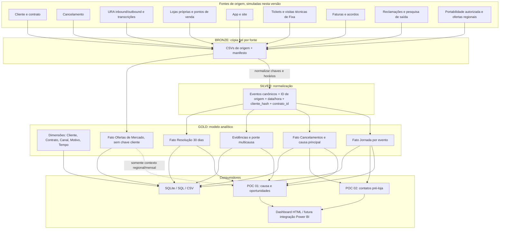
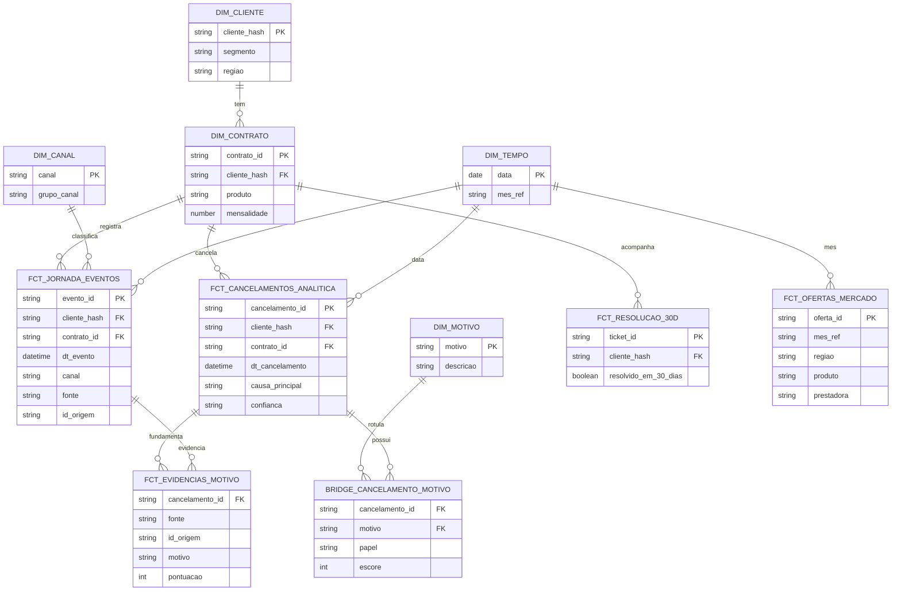

# Arquitetura de dados — CLARO Customer Journey & Churn Intelligence

> **POC v0.1 — 100% sintética, não oficial.** Outubro/2026 é a coorte; abril-setembro são meses comparativos fechados. A janela de 180 dias é móvel por evento de cancelamento.

## 1. Diagrama de arquitetura medallion

### Por que não unir tudo diretamente?

Cada canal tem **granularidade distinta**: ligação, visita, ticket, fatura, atendimento digital e cancelamento. Juntar as tabelas brutas por `cliente_hash` produziria multiplicação de linhas (ex.: 4 ligações × 2 visitas × 3 faturas = 24 registros) e percentuais errados. Em vez disso:

1. Fontes possuem `cliente_hash` + `contrato_id` + chave de evento de origem.
2. Silver cria **um evento por interação** em `eventos_canonicos`.
3. Gold expõe uma tabela de **uma linha por cancelamento** (`fct_cancelamentos_analitica`).
4. Evidências e motivos contribuintes ficam em tabelas separadas com cardinalidade N:1 para o cancelamento.
5. A dimensão `dim_cliente` não deve conter identificação civil em ambiente de analytics.
6. Mercado externo **não possui** `cliente_hash`; o contexto se conecta por `mes_ref + regiao + produto`. Não é prova individual de mudança.

## 2. Diagrama entidade-relacionamento lógico

> O ERD representa as relações **lógicas**. A base SQLite demonstrativa cria colunas do CSV como `TEXT`, não FKs físicas; índices são criados para chaves principais de acesso. Ao homologar dados reais, introduzir tipos estritos, constraints, relacionamento composto quando houver múltiplos contratos e carga incremental.

## 3. Granularidade por camada

| Tabela | Grão | Chaves / junção |
|---|---|---|
| `dim_cliente` | 1 linha/cliente sintético | `cliente_hash` |
| `dim_contrato` | 1 linha/contrato | `contrato_id`, `cliente_hash` |
| `fct_jornada_eventos` | 1 linha/evento do canal | `evento_id`, `cliente_hash`, `contrato_id`, `dt_evento` |
| `fct_cancelamentos_analitica` | 1 linha/cancelamento | `cancelamento_id`, `contrato_id` |
| `bridge_cancelamento_motivo` | 1 linha/cancelamento/motivo sustentado | `cancelamento_id`, `motivo` |
| `fct_evidencias_motivo` | 1 linha/evidência detectada | `cancelamento_id`, `fonte`, `id_origem` (pode ter múltiplos motivos/evidências) |
| `fct_resolucao_30d` | 1 linha/ticket de suporte | `ticket_id`, `contrato_id` |
| `fct_pre_loja_30d` | 1 linha/visita à loja | `atendimento_loja_id` |
| `fct_transicoes_canais` | 1 linha/tipo de transição/produto agregado | `produto`, `canal_origem`, `canal_destino` |
| `fct_ofertas_mercado` | 1 linha/oferta/operadora/região/mês | `mes_ref`, `regiao`, `produto` |

## 4. Produto e canais

- **MÓVEL**: chip/linha/plano; URA, lojas, pontos de venda, app, site, financeiro, reclamações; **não** recebe visita técnica residencial nesta POC.
- **FIXA**: banda larga residencial/equipamentos; todos os canais correspondentes, **mais** suporte técnico e visita residencial.
- Em produção, separar contratos de banda larga de eventual telefonia fixa e outros serviços para evitar extrapolar regras de portabilidade numérica.
- **URA inbound/outbound**: uma ligação por registro; se houver gravação/transcrição real, integrá-la com autorização, minimização de PII e classificação supervisionada.

## 5. Temporalidade e recortes

| Visão | Intervalo | Objetivo |
|---|---|---|
| Coorte de cancelamento | 01/10/2026 a 31/10/2026 | Quem cancelou, produto e data |
| Calendário fechado | 01/04/2026 a 30/09/2026 (183 dias) | Comparar meses anteriores |
| Janela individual | `[timestamp_cancelamento - 180 dias, timestamp_cancelamento)` | Evidências causais e sequência completa, inclusive outubro pré-saída |
| Pré-loja | `[timestamp_visita - 30 dias, timestamp_visita)` | O que aconteceu antes do atendimento presencial |
| Resolução | até 30 dias a partir da abertura do ticket, observando o corte | Resolver até 30 dias não significa necessariamente evitar cancelamento |

## 6. Rastreabilidade

`evento_id = nome_fonte + ':' + id_origem`. Cada evidência grava `cancelamento_id`, `fonte`, `id_origem`, `pontuacao` e `dt_evidencia`. Desse modo é possível responder: **qual evento fundamentou cada hipótese, quando, em qual canal e com qual confiabilidade?**

No cenário produtivo, adicionar `ingested_at`, `source_system`, `source_file`, `source_watermark`, `row_hash`, `run_id`, `taxonomy_version` e manifesto por partição.
