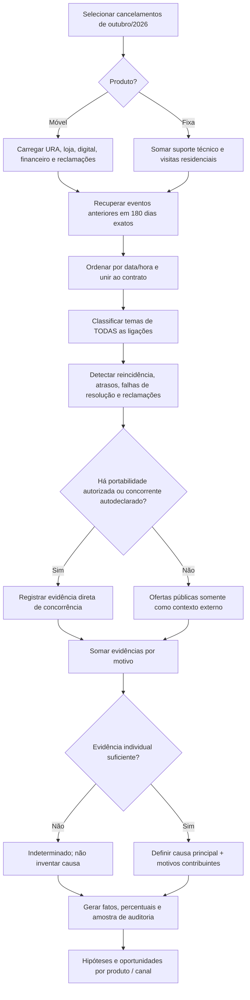
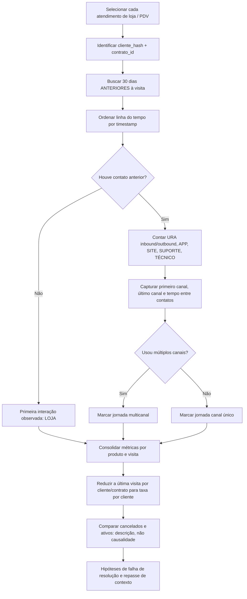
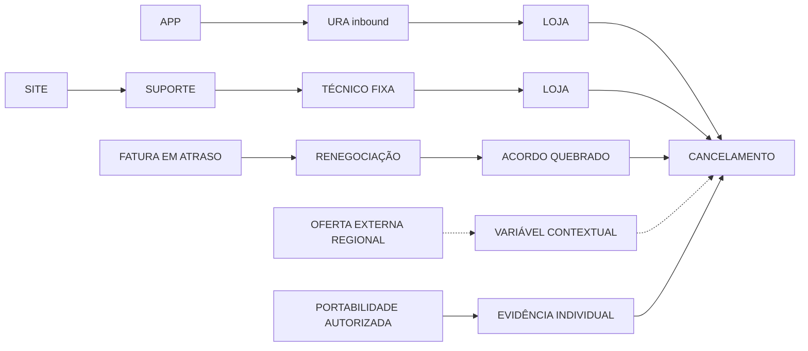

# Fluxogramas funcionais e jornadas

## POC 01 — Investigação da raiz do cancelamento

### Exemplo sintético de encadeamento

| Data ilustrativa | Canal | Evento | Evidência |
|---|---|---|---|
| 18/08 | APP | Registro de instabilidade | Sinal inicial |
| 22/08 | URA inbound | Reclamação de queda | Reincidência |
| 26/08 | Técnico residencial (Fixa) | Visita sem solução | Falha técnica |
| 10/09 | Técnico residencial (Fixa) | Segunda visita | Problema persistente |
| 24/09 | Loja própria | Cliente volta a pedir ajuda | Escalada entre canais |
| 15/10 | Cancelamento | Motivo declarado: preço | **Possível divergência** entre motivo declarado e histórico técnico |

O exemplo acima é didático; o pipeline possui casos sintéticos gerados de forma aleatória e determinística. A causa é **hipótese baseada em evidências**, não diagnóstico com validade jurídica ou causalidade comprovada.

## POC 02 — O que aconteceu antes de chegar à loja?

## Jornadas comuns a investigar

## Gatilhos candidatos

| Gatilho observável | Critério de estudo inicial | Exemplo de ação futura (não automática) |
|---|---|---|
| URA → loja | URA até 30 dias antes da visita | Verificar se o atendente de loja recebeu histórico |
| App/site → loja | Uso digital com retorno `SEM_SOLUCAO` | Investigar falha de autosserviço |
| Visitas repetidas | 2+ visitas técnicas em Fixa | Avaliar qualidade da solução técnica |
| Ticket pendente | Ticket sem fechamento no instante do cancelamento | Investigar fila e prazo |
| Alto esforço | 3+ ligações não resolvidas em 180 dias | Propor caso único no CRM |
| Financeiro | Inadimplência + acordo quebrado | Analisar recuperação e comunicação |
| Reclamação aberta | Reclamação pública/OUVIDORIA não resolvida | Revisar resposta e escalada |
| Oferta externa | Oferta abaixo da mensalidade contratual na região/mês | Hipótese de pressão competitiva **agregada**, sem classificar cliente |
| Saída não explicada | Nenhuma evidência robusta | Melhorar pesquisa de saída e integração de fontes |
